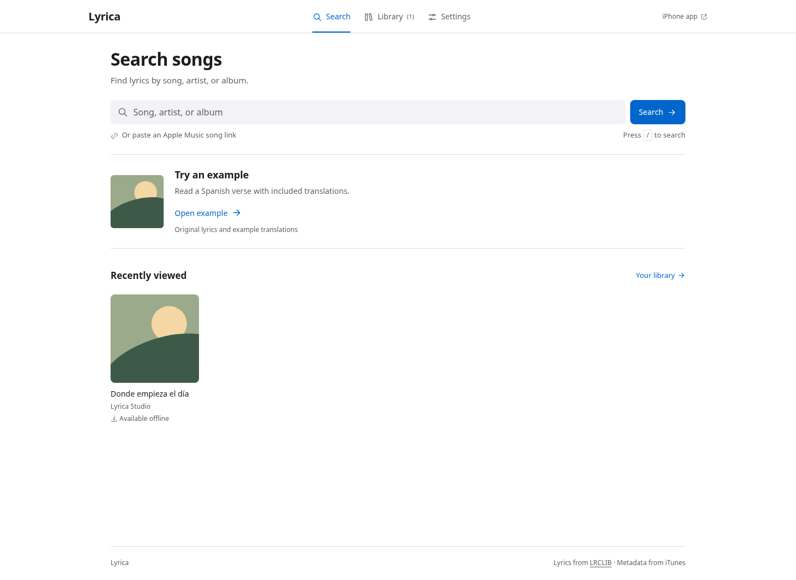
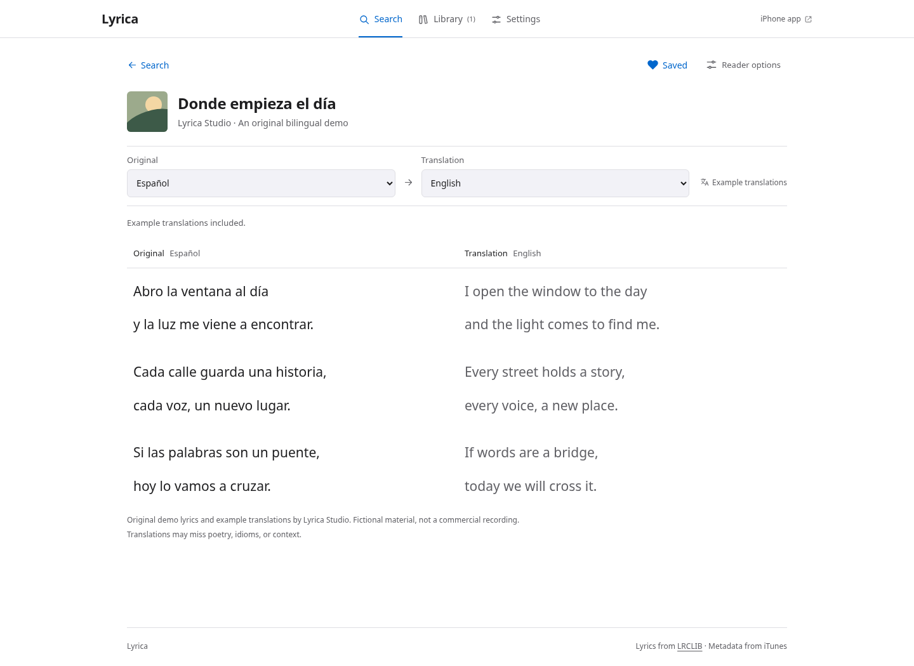
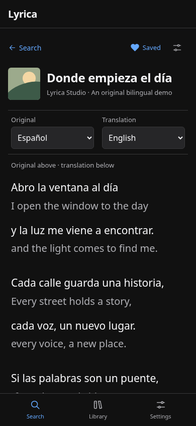
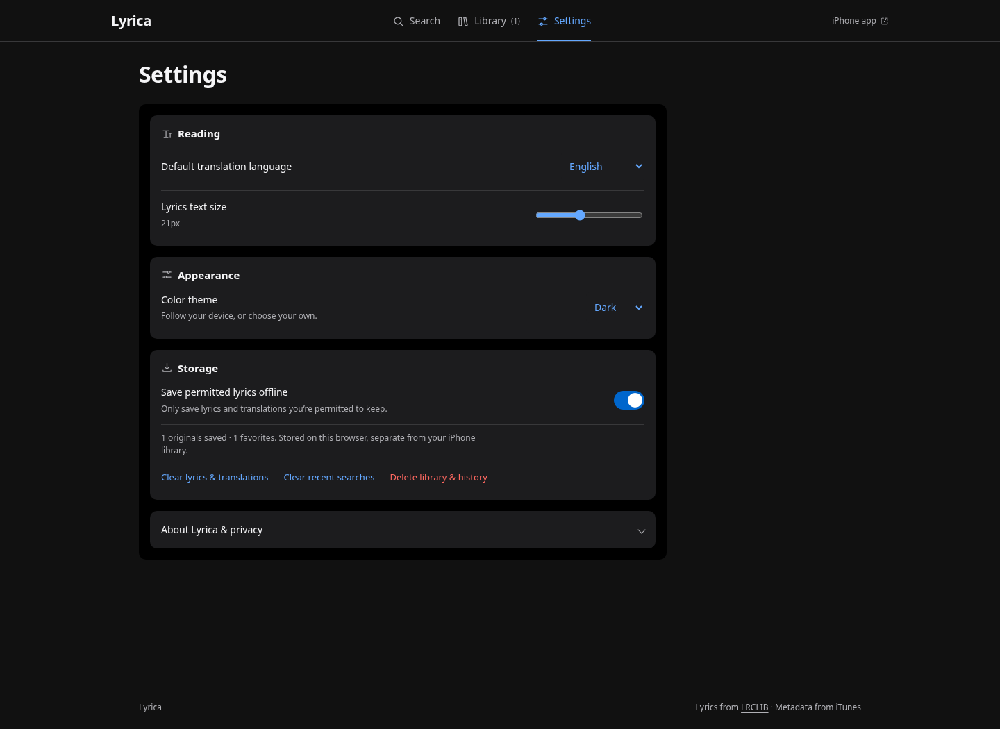
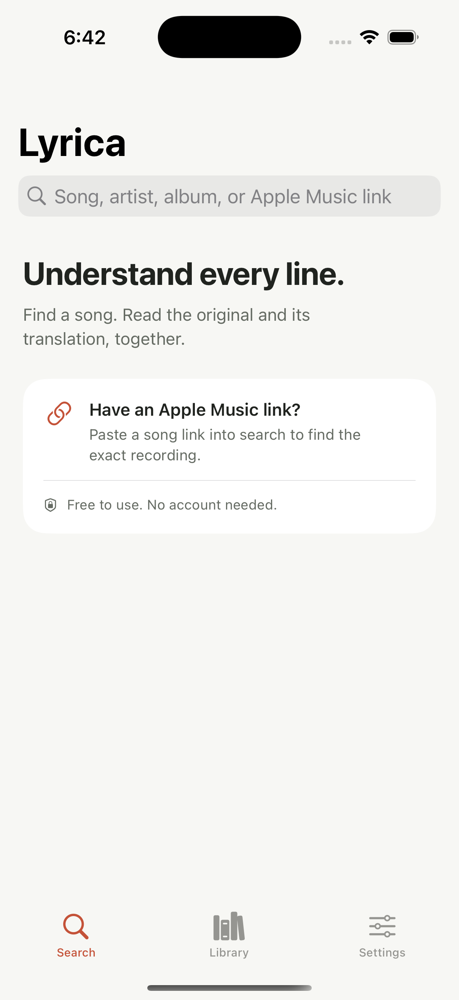
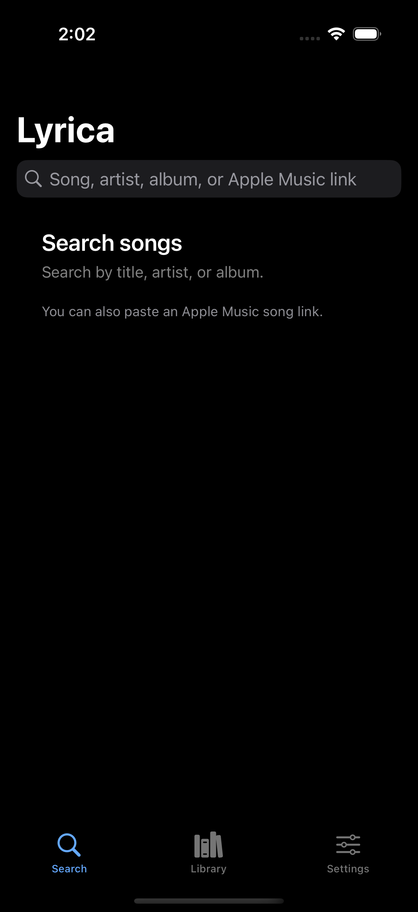

# Lyrica

Lyrica is a native iPhone app for reading original lyrics alongside on-device translations. Search for a song or paste its Apple Music link, select the recording, and open the bilingual reader. There is no playback, account, subscription, paid API, or app backend.

Built with **SwiftUI · Swift · iOS 18+ · SwiftData · Apple Translation**.

## Video walkthrough

[Watch the phone-and-desktop MP4 walkthrough](docs/lyrica-walkthrough.mp4). It is recorded from the running web app, with captions outside the controls and original fictional demo lyrics. Included translations demonstrate the interface; this video does not demonstrate a browser model download.

## Web version

The browser companion is included in [`web/`](web/README.md), committed directly to `main` alongside the iOS app. Run it without installing dependencies:

```sh
python3 -m http.server 4173 --directory web
```

Open **http://localhost:4173**. Search real songs or choose **Open example** to test immediately. Web translation supports **Spanish, Arabic, and French → English** through optional downloadable on-device models, including a WebAssembly fallback for browsers without the Translator API. Models need approximately 110–120 MB per language plus a shared 23 MB engine. Actual iPhone browser performance still needs device testing; Apple Translation is exclusive to the native app. See [web translation details](docs/WEB_TRANSLATION.md). Both versions use free services and opt-in local lyric storage.

These are real screenshots from the browser implementation:

<p> </p>

See [web setup, browser compatibility, tests, and free hosting](web/README.md). GitHub Pages deployment is prepared; repository Pages must be enabled before a live URL is available.

## Interface

The web and iOS apps use system fonts, neutral light/dark backgrounds, blue controls, compact spacing, and flat lyric rows. The iPhone app uses native lists, forms, navigation, and Dynamic Type. Web navigation adapts from a plain header to a phone tab bar; both readers keep original and translated lines aligned.

[Design system](docs/DESIGN.md) · [UI audit](docs/UI_AUDIT.md) · [24 real web screenshots](docs/web/screenshots/) · [Device acceptance checklist](docs/DEVICE_TESTING.md)

<p> </p>

The older illustrated concepts in `docs/previews/` are historical design studies. The screenshots above are captured from the current running app; original demo lyrics are labeled, and no screenshot demonstrates a model download.

These light/dark iPhone Search captures are from an earlier successful simulator run. The latest native builds and tests pass, but the optional screenshot export timed out before producing fresh images:

<p> </p>

## What it does

- **Find the right song:** debounced iTunes search by song, artist, or album, artwork and recording metadata, recent searches, and Apple Music song-link lookup. Album links that contain an `i=` song ID work too; album-only links ask for a song.
- **Retrieve lyrics responsibly:** LRCLIB metadata matching uses artist, title, album, and duration. Plain lyrics take priority; timestamped lyrics are cleaned without flattening verses. Uncertain matches and instrumental recordings have explicit states. You can paste lyrics you have permission to use when a match is unavailable.
- **Translate locally:** Apple’s Translation framework translates individual nonblank lines while retaining row identifiers and stanza breaks. English is the initial target. The picker uses languages supported by the device, including Spanish, French, Italian, Portuguese, Arabic when available, and others. Language detection can be corrected manually.
- **Read comfortably:** one scrolling surface keeps both columns aligned, with wrapping, paired line highlighting, an optional stacked layout, adjustable text size, Dynamic Type, VoiceOver labels, and right-to-left text direction per language.
- **Keep a personal library:** favorites, searchable viewing history, opt-in local lyric and translation caching, offline reading of stored content, and controls to remove cached or all app data.
- **Make it yours:** default translation language, text size, system/light/dark appearance, and storage management.

## Install and run

You need a Mac with **Xcode 16 or later**, an **iOS 18+ iPhone**, and an Apple ID for personal device signing. The repository includes a complete Xcode project; no project generator, CocoaPods, API key, server, or third-party Swift package is needed.

```sh
git clone https://github.com/Kerollosl/lyrica.git
cd lyrica
open Lyrica.xcodeproj
```

1. Select the **Lyrica** scheme.
2. In **Signing & Capabilities**, choose your development team. If needed, use your own unique bundle identifier.
3. Select your connected iPhone and run.
4. Search for a Spanish song, or paste its Apple Music song link into the search field.
5. Choose the correct recording. Lyrica retrieves the available lyrics and prepares an English translation.
6. Accept Apple’s language-model download prompt if required. Switch languages in the reader, highlight a line, or save the song.
7. To read lyrics offline, enable local storage only for material you are permitted to store. First translate each language you want available offline.

A free Apple ID can install a development build on your own device, subject to Apple’s personal-team provisioning restrictions and periodic re-signing (typically every seven days). App Store/TestFlight distribution requires the usual Apple Developer Program membership; Lyrica itself has no recurring service costs.

### Translation and device requirements

Apple Translation is system-provided. **Test actual translation on a physical supported iPhone**; simulator translation/model installation is not a reliable acceptance environment. Language support varies with OS, device, and installed models. The app checks the requested language pair and explains unsupported combinations. A supported but uninstalled pair may require a one-time download and consent through Apple’s UI. After models are installed, translation runs on device. Model downloads need an internet connection and storage.

Short or multilingual lyrics may be detected incorrectly; select the source language manually. Machine translations may lose rhyme, idioms, context, or meaning. Line-by-line translation preserves reading alignment but gives the translator less surrounding context than a whole verse. There is no guarantee that any particular song, language pair, or recording is available.

## Build and test

The pure-Foundation `LyricaCore` package contains networking, URL parsing, lyric normalization, matching, and lyrics normalization logic. The app target contains SwiftUI, SwiftData, and Apple Translation integration.

```sh
# Core logic and mocked networking tests (Swift 6 toolchain / Xcode 16+).
swift test

# Apple SDK compile check without device signing.
xcodebuild build \
  -project Lyrica.xcodeproj \
  -scheme Lyrica \
  -destination 'generic/platform=iOS Simulator' \
  CODE_SIGNING_ALLOWED=NO

# Native SwiftData tests; substitute an installed simulator name.
xcodebuild test \
  -project Lyrica.xcodeproj \
  -scheme Lyrica \
  -destination 'platform=iOS Simulator,name=iPhone 16' \
  CODE_SIGNING_ALLOWED=NO
```

The GitHub Actions workflow runs core tests, compiles the iOS app, and runs native persistence tests on macOS with an available iPhone simulator. Read the actual workflow result before treating Apple-SDK validation as passed.

### Verification

The app is authored in Linux; native compilation and simulator execution run in GitHub’s macOS CI. Web checks run domain tests and deterministic browser workflows, including a 390/768/1440px light/dark matrix, RTL, large text, storage, failure states, keyboard access, and offline shell behavior. The native workflow builds device and simulator paths, runs core and persistence/view-model tests, and captures light/dark Search screens. See the actual [workflow results](https://github.com/Kerollosl/lyrica/actions).

Real-device Translation downloads, translation quality, VoiceOver, and device-specific behavior remain part of the [device acceptance checklist](docs/DEVICE_TESTING.md).

## Architecture

```text
Lyrica/
  LyricaApp.swift       App lifecycle and shared environment
  Models/              Observable app preferences
  Persistence/         SwiftData models and local repository
  Translation/         System language catalog and detection
  ViewModels/          Search and reader state, cancellation, cache orchestration
  Views/               Search, bilingual reader, library, settings, reusable components
  Assets.xcassets/     Original icon and accent color
Sources/LyricaCore/    Portable domain models, URLSession clients, matching and parsing
Tests/LyricaCoreTests/ Pure logic and mocked HTTP coverage
LyricaTests/           In-memory SwiftData regression tests
```

MVVM keeps rendering separate from request/state orchestration. Network clients use `URLSession`, typed errors, bounded requests, and async cancellation. The search task is debounced and replaced as input changes. Translation work is bound to the SwiftUI Translation session lifecycle; indexed responses preserve alignment even if a batch returns out of order. Local translations are keyed to the source text and source/target languages so editing the lyrics cannot reuse an unrelated result.

The Xcode project uses Xcode 16 filesystem-synchronized groups: adding a Swift file under `Lyrica/` or `LyricaTests/` includes it in the corresponding target automatically. The only package dependency is this repository’s local `LyricaCore` package.

## Lyrics, licensing, and attribution

**Availability is not permission.** LRCLIB is a community lyrics database; its API response does not grant copyright or redistribution rights. Song lyrics, translations, artwork, and metadata may be protected by their respective owners’ rights. Users must comply with the law, the source services’ terms, and rights applicable to their use and location.

Lyrica retrieves lyrics only from the public **[LRCLIB API](https://lrclib.net/docs)**. It does not scrape lyric websites, bypass access restrictions, bundle commercial lyrics, upload pasted text, or publish a lyric database. Manual input is for material you are authorized to use. Automatic translation does not create a license to reproduce or distribute protected lyrics or derivative translations.

Local storage of original lyrics and translations is **off until the user opts in for permitted material**. Metadata history can be kept without storing lyric text. Favorites alone do not imply that every lyric is available offline; offline reading requires an allowed local copy. Settings can clear lyric/translation caches or remove all library/history data. Turning off offline storage removes existing saved lyrics and translations while retaining metadata bookmarks. Saved copies may remain subject to rights restrictions.

Song search and artwork are supplied by the **[iTunes Search API](https://developer.apple.com/library/archive/documentation/AudioVideo/Conceptual/iTuneSearchAPI/)**. Apple and LRCLIB are independent services; Lyrica is not affiliated with or endorsed by them. Their availability, access policies, and rate limits can change. API clients avoid background crawling and surface rate-limit failures so users can retry later.

There is no music playback, lyric-to-audio synchronization, paid AI service, or unlimited-content guarantee.

## Privacy and offline behavior

Search queries and requested metadata are sent directly to Apple; song metadata needed to locate lyrics is sent directly to LRCLIB. Those services receive ordinary network connection information, such as the IP address. Artwork is loaded from Apple’s supplied artwork URLs. There is no analytics, advertising SDK, authentication, app-operated server, or cloud sync.

Lyrics translation uses Apple’s system framework. Apple may download translation models with the user’s consent. Preferences and permitted saved content are stored in the app’s local sandbox with SwiftData/UserDefaults. OS-managed backups may include app data according to the user’s system settings. Cache deletion in Lyrica does not manage Apple’s system language-model downloads.

Search and retrieving new lyrics require a connection. Previously saved lyric/translation pairs can be read offline without a network request; metadata-only history needs retrieval again. Removing the app removes its local sandbox, subject to normal OS backup behavior.

## Development notes

- The original artwork and text in `docs/previews/` are illustrative only.
- `scripts/generate_previews.py` regenerates the icon and design previews with Python 3, Pillow, and the open-source P052 font available on the authoring system; it is not needed to build the app.
- `python3 scripts/record_web_walkthrough.py` records the current app on phone and desktop and exports a captioned MP4. Start the local web server first.
- No signing certificates, provisioning profiles, secrets, or API tokens belong in this repository.
- The repository’s source-code availability does not convey rights in third-party lyrics, translations, album art, or trademarks. No open-source license has been selected on behalf of the repository owner.
